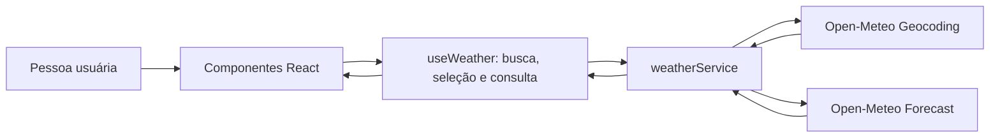

# Plano Técnico — SDD Weather App

> Fonte da verdade funcional: [especificação do produto](../specs/weather-app-spec.md). Este documento define decisões e contratos para orientar as tarefas; não substitui nem amplia os critérios de aceite.

## Architecture Overview

Aplicação cliente em React, organizada em apresentação, coordenação de estado e serviços de dados. A interface não acessa a Open-Meteo diretamente: serviços dedicados fazem as requisições, validam a resposta e a convertem para modelos internos. O estado fica no cliente e não há servidor próprio.



O fluxo suporta busca de localidades, seleção e consulta meteorológica separadas. A camada de apresentação renderiza loading, vazio e erro sem acoplar os componentes ao formato externo da API. Essa separação atende RF1–RF6, RNF2 e RNF4.

## Tech Stack

| Tecnologia | Uso e justificativa |
| --- | --- |
| TypeScript strict | Contratos explícitos para respostas externas e modelos internos; reduz inconsistências entre clima atual e previsão (RF3–RF5). |
| React 19 | Componentes para busca, seleção, clima atual, previsão e estados da consulta. |
| Vite | Servidor de desenvolvimento e build cliente; mantém a carga inicial pequena (RNF3). |
| Tailwind CSS | Estilos responsivos conforme a configuração existente; possibilita priorizar telas estreitas (RNF1). |
| Open-Meteo Geocoding e Forecast | Busca de localidades e dados meteorológicos sem chave de API (RF1–RF4, RNF6). |
| Vitest + Testing Library | Testes de unidades, serviços, hooks e interação de componentes. |
| Playwright | Verificação dos fluxos integrados em navegadores evergreen e larguras móveis. |
| Biome | Lint e formatação conforme as ferramentas já configuradas no repositório. |

Não adicionar biblioteca de estado global nem cliente HTTP nesta versão: estado local do React e `fetch` atendem ao fluxo sem dependências extras.

## Project Structure

Estrutura prevista, alinhada ao repositório atual:

| Caminho | Responsabilidade |
| --- | --- |
| `src/App.tsx` | Compor a tela e conectar os componentes ao hook de consulta. |
| `src/components/` | Busca, alternância de unidade, clima atual, previsão e componentes de estado. |
| `src/components/states/` | Apresentações reutilizáveis de loading, erro e estado vazio. |
| `src/hooks/useWeather.ts` | Coordenar busca, seleção, carregamento, retry e unidade de temperatura. |
| `src/services/weatherService.ts` | Requisições Open-Meteo, validação básica e normalização dos dados. |
| `src/types/weather.ts` | Modelos internos compartilhados e estados/erros de consulta. |
| `src/lib/temperature.ts` | Conversão e formatação de temperaturas. |
| `src/lib/format.ts` | Formatação localizada de valores e datas. |
| `src/lib/weatherCodes.ts` | Mapeamento de códigos meteorológicos para rótulos e ícones. |
| `src/styles/` | Estilos globais e configuração visual. |
| `tests/unit/` | Testes unitários e de integração de componentes/serviços. |
| `tests/e2e/` | Fluxos completos de busca, consulta, alternância e recuperação. |

Manter os arquivos e responsabilidades existentes; criar novos módulos apenas quando uma tarefa identificar uma necessidade concreta.

## Data Model

Os modelos internos isolam a UI dos nomes e da estrutura específicos da API. Dados que podem faltar são anuláveis para permitir apresentação parcial (RF3 e RF4).

```ts
type TemperatureUnit = 'celsius' | 'fahrenheit';

interface City {
  id: number | null;
  name: string;
  adminRegion: string | null;
  country: string | null;
  countryCode: string | null;
  latitude: number;
  longitude: number;
  timezone: string | null;
}

interface CurrentWeather {
  observedAt: string | null;
  temperatureC: number | null;
  weatherCode: number | null;
  humidityPercent: number | null;
  windSpeedKmh: number | null;
  pressureHpa: number | null;
  precipitationMm: number | null;
}

interface ForecastDay {
  date: string;
  minimumC: number | null;
  maximumC: number | null;
  weatherCode: number | null;
  precipitationMm: number | null;
}

interface WeatherSnapshot {
  city: City;
  current: CurrentWeather;
  forecast: ForecastDay[];
  timezone: string | null;
}
```

Temperaturas ficam normalizadas em Celsius; conversão para Fahrenheit ocorre na apresentação, para garantir que a unidade escolhida se aplique a todos os valores e evitar buscas duplicadas (RF5). A previsão deve conter hoje e os quatro dias seguintes; se a API retornar menos dias, os dias ausentes são tratados como indisponíveis, nunca inventados.

## Data Flow

1. A pessoa informa um nome e envia a busca. Entrada vazia ou composta somente por espaços não gera requisição (edge case da spec).
2. O hook atualiza o estado de busca para loading e chama a operação de geocodificação no serviço.
3. O serviço normaliza os resultados para `City`; lista vazia resulta em estado vazio, enquanto falha de transporte ou resposta inválida resulta em erro.
4. A interface apresenta resultados com região e país disponíveis. Selecionar um resultado define a cidade ativa, sem confundir a seleção com a conclusão da consulta meteorológica.
5. O hook inicia a consulta meteorológica para latitude/longitude da cidade selecionada e apresenta loading.
6. O serviço converte a resposta em `WeatherSnapshot`. A UI apresenta cidade, clima atual e exatamente os cinco dias do período solicitado; para um dia ausente na resposta, mantém a data prevista e indica seus valores como indisponíveis.
7. Alternar unidade recalcula somente valores apresentados; não dispara nova busca nem consulta (RF5).
8. Retry repete a última operação que falhou, com os mesmos parâmetros. Uma resposta de busca anterior ou de cidade anterior não deve substituir o resultado da operação mais recente.

## External APIs

Base URL: `https://geocoding-api.open-meteo.com/v1/search` e `https://api.open-meteo.com/v1/forecast`. Não é necessária chave de API.

### Geocoding

- Método: `GET`.
- Parâmetros: `name` (termo aparado), `count=10`, `language=pt`, `format=json`.
- Campos consumidos: `id`, `name`, `admin1`, `country`, `country_code`, `latitude`, `longitude`, `timezone`.
- `results` ausente ou vazio significa nenhum resultado; falha HTTP/rede não deve ser apresentada como cidade inexistente.
- Busca por envio explícito e no máximo 10 resultados, conforme a Open Question 6 aprovada na spec.

### Forecast

- Método: `GET`.
- Parâmetros: `latitude`, `longitude`, `current=temperature_2m,relative_humidity_2m,weather_code,wind_speed_10m,pressure_msl,precipitation`, `daily=weather_code,temperature_2m_max,temperature_2m_min,precipitation_sum`, `temperature_unit=celsius`, `wind_speed_unit=kmh`, `precipitation_unit=mm`, `timezone=auto`, `forecast_days=5`.
- Campos consumidos: `current.time`, campos selecionados de `current`, `daily.time` e os campos diários solicitados; usar `timezone` da resposta para contextualizar datas.
- A aplicação solicita Celsius em todos os casos e converte localmente para Fahrenheit quando selecionado.
- Validar status HTTP e presença/formato dos campos necessários à estrutura; campos meteorológicos individuais ausentes viram `null`, não falha total.

As unidades fixas de vento e precipitação são apresentadas como km/h e mm, respectivamente. Isso mantém a leitura consistente em pt-BR; mudanças de unidade não fazem parte da spec.

## State Management

Manter o estado no hook `useWeather`, sem store global. Separar estado de busca de localidades do estado de consulta meteorológica, pois a busca pode ter sucesso mesmo quando a consulta do clima falha.

```ts
type AsyncState<T> =
  | { status: 'idle' }
  | { status: 'loading' }
  | { status: 'success'; data: T }
  | { status: 'empty' }
  | { status: 'error'; error: WeatherError };

interface WeatherViewState {
  search: AsyncState<City[]>;
  selectedCity: City | null;
  weather: AsyncState<WeatherSnapshot>;
  unit: TemperatureUnit;
}
```

A unidade começa em Celsius e a seleção não persiste entre sessões, conforme a suposição da spec de ausência de persistência na primeira versão. Não introduzir `localStorage` (Open Question 1 aprovada: sem persistência). Para impedir resultados obsoletos, cancelar requisições substituídas quando possível e ignorar respostas de operações anteriores.

## Error Handling

Representar erro recuperável com uma categoria interna e mensagem apropriada à interface; não expor detalhes técnicos da resposta ou da rede.

```ts
type WeatherError =
  | { kind: 'network' }
  | { kind: 'http'; status: number }
  | { kind: 'timeout' }
  | { kind: 'invalid-response' };
```

- Loading: indicar qual operação está em andamento (busca ou clima).
- Vazio: busca concluída com zero cidades é distinta de falha; não selecionar automaticamente uma cidade.
- Erro: apresentar mensagem em pt-BR e ação de retry na operação correspondente (RF6, US5).
- Falha do clima: preservar a cidade selecionada e comunicar que os dados meteorológicos não foram carregados; não dizer que a cidade não existe.
- Resposta parcial: renderizar os campos válidos e identificar cada valor indisponível sem ocultar o restante (RF3 e RF4).
- Timeout: abortar a requisição e permitir retry; limites aprovados de 5 s para busca e 10 s para clima (Open Question 4).
- Consulta concorrente: ignorar resultado tardio de busca/clima que já não corresponde à operação/cidade ativa.
- Dados antigos em cache não serão exibidos nesta versão, conforme a Open Question 2 aprovada; evita apresentar dados obsoletos como atuais.

## Testing Strategy

Derivar os testes dos critérios de aceite da spec e manter os testes determinísticos, simulando respostas e falhas da API.

| Camada | Verificações principais |
| --- | --- |
| Unitários de lib | Conversão C/F; formatação pt-BR; mapeamento de códigos meteorológicos, incluindo códigos desconhecidos. |
| Unitários de serviço | Parâmetros/endpoints de geocoding e forecast; normalização de resultados; campos ausentes; lista vazia; falhas de rede, HTTP, timeout e resposta inválida. |
| Hook/componentes | Entrada vazia; estados loading/vazio/erro; seleção correta; retry da operação apropriada; valores parciais; alternância de todas as temperaturas sem nova requisição; respostas antigas ignoradas. |
| E2E Playwright | Fluxo buscar → distinguir/selecionar cidade → consultar clima e cinco dias → alternar unidade; busca sem resultados; recuperação por retry; viewport mínimo de 320 px e navegação por teclado. |

Usar Vitest, Testing Library e Playwright já configurados. Testes de interface devem verificar comportamento observável e acessibilidade por roles/labels. No E2E, interceptar os endpoints externos para evitar dependência da disponibilidade da Open-Meteo; manter pelo menos um caminho de integração real como validação manual, não requisito para cada execução de CI.

## Risks & Trade-offs

| Risco ou trade-off | Decisão/mitigação |
| --- | --- |
| Open-Meteo lenta, indisponível ou limitando chamadas | Tratar timeout e falhas de forma recuperável; evitar chamadas ao alternar unidade; revisar limites da fonte antes da entrega (RF6, RNF4). |
| Homônimos levam à seleção errada | Mostrar estado/região e país disponíveis; exibir claramente a cidade ativa (RF1–RF2). |
| Resposta parcial não coincide com o modelo esperado | Normalizar no serviço e representar campos opcionais como `null`; cobrir formatos incompletos nos testes (RF3–RF4). |
| Conversão de unidade divergente entre componentes | Manter Celsius como dado canônico e compartilhar conversão/formatação na camada de apresentação (RF5). |
| Fuso horário e atualidade da informação podem confundir | Solicitar `timezone=auto` e usar datas locais fornecidas pela API; horário da observação no fuso da cidade (Open Question 3 aprovada). |
| Limites de tempo | Aprovados: 5 s para busca e 10 s para clima; definidos em constantes nomeadas (Open Question 4). |
| Busca explícita e limite de 10 resultados | Aprovados (Open Question 6): envio explícito, sem busca enquanto digita. |
| Sem persistência/cache, nova visita exige nova consulta e falha de rede não mostra dado anterior | Manter o escopo simples e evitar informação possivelmente desatualizada; decisões aprovadas nas Open Questions 1 e 2. |
| Sem biblioteca global, expansão do fluxo pode elevar complexidade do hook | Manter enquanto estado e fluxos forem locais à tela; reconsiderar somente se novas funcionalidades exigirem estado compartilhado. |